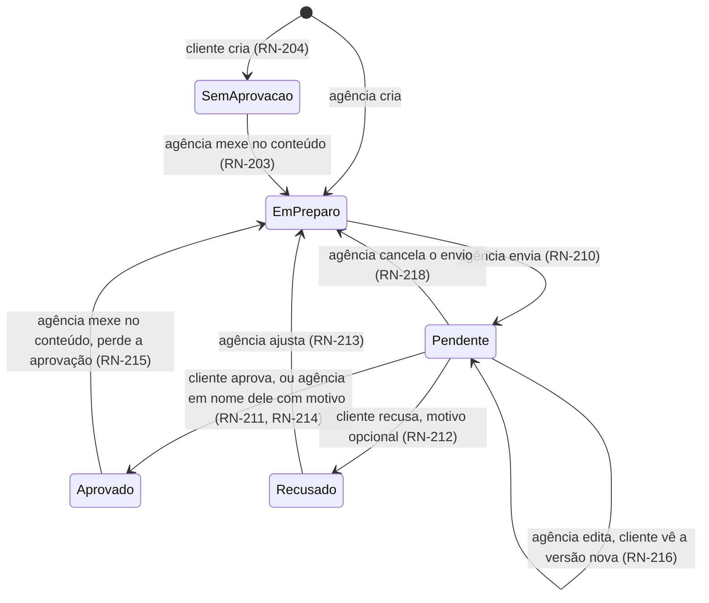

# Regras de Negócio — ConvergIA

> Documento principal do projeto. `stack.md` e `software_design.md` derivam daqui.
> Referência estudada: Dalea AI (https://usedalea.ai/docs/mcp), lida em 12/11/2026.

## 0. Como ler este documento

Cada regra tem um ID (`RN-xxx`) e uma marcação de origem:

| Marca | Significado |
|---|---|
| ✅ **Confirmado** | Você decidiu isso explicitamente nas perguntas. |
| 📎 **Referência Dalea** | É assim que o Dalea funciona, segundo a documentação. **Não está decidido para o nosso produto.** Serve de ponto de partida e precisa da sua confirmação. |
| ❓ **Em aberto** | Ninguém decidiu ainda. Não deduzi nada aqui. Tudo está listado na seção 8. |

Regras 📎 e ❓ não devem ser implementadas sem confirmação.

---

## 1. Contexto do negócio

- ✅ **RN-001** — Quem opera a ferramenta é uma **agência de tráfego e marketing**.
- ✅ **RN-002** — A agência oferece a ferramenta aos **seus clientes**, que são empresas de qualquer segmento (loja de móveis, criador de conteúdo, personal trainer, loja de roupas etc.). O produto **não** é segmentado por nicho.
- ✅ **RN-003** — A ferramenta é acessada por **clientes MCP** (Claude, ChatGPT, Claude Code, Cursor...). **Não há app web próprio no protótipo.**
- ✅ **RN-004** — **Não há cobrança no protótipo.** Haverá cobrança no futuro; o modelo ainda não foi definido (❓ Q-30).

### O que a ferramenta faz (protótipo)

Ajuda cada empresa cliente a **planejar e produzir conteúdo orgânico para Instagram** com base no próprio desempenho: lê métricas, gera insights, organiza um calendário editorial, gera e refina roteiros com IA, sugere ideias, guarda referências e cria carrosséis. O conteúdo criado pela agência para um cliente passa pela aprovação desse cliente.

---

## 2. Escopo

### 2.1 Dentro do protótipo ✅

| Módulo | Inclui |
|---|---|
| **Acesso e multiempresa** | Agência, empresas clientes, usuários, isolamento de dados |
| **Desempenho e insights** | Conectar Instagram, sincronizar métricas, analisar posts, gerar insights |
| **Conteúdo e roteiros** | Cards, kanban, calendário editorial, fontes (artigo/texto/PDF), geração e refino de roteiro, brainstorm de ideias |
| **Referências** | Salvar posts e perfis de referência por URL, analisar criadores de referência |
| **Carrossel** | Criar carrossel (planejar, escrever lâminas, gerar arte) e renderizar as imagens |
| **Aprovação** | Fluxo novo, que o Dalea não tem (seção 5) |
| **Cotas** | Limite diário de uso das ferramentas de IA e de scraping |

### 2.2 Fora do protótipo

| Item | Situação | Origem |
|---|---|---|
| Editor de vídeo (cortes, legendas, zooms, renderização) | **Removido do produto** | ✅ |
| Módulo de marca (ficha da empresa, brand kit, entrevista de estratégia, fatos, restrições, memória) | Depois | ✅ |
| Catálogo viral compartilhado (vídeos e criadores de terceiros) | Fase 2 | ✅ |
| Benchmarks de nicho (dependem do catálogo) | Fase 2 | 📎 depende do catálogo |
| Tráfego pago (campanhas de anúncios) | Fase 2 | ✅ |
| TikTok | Depois | ✅ |
| Agendamento e publicação de carrossel no Instagram | Depois | ✅ |
| Aprovação da data de planejamento no calendário | Depois | ✅ |
| Cobrança e assinatura | Futuro | ✅ |
| App web | Futuro | ✅ |

---

## 3. Atores e papéis

### 3.1 Atores

| Ator | Descrição | Origem |
|---|---|---|
| **Agência** | A organização dona da ferramenta. Existe uma só no protótipo (❓ Q-01). | ✅ |
| **Membro da agência** | Pessoa da equipe da agência. | ✅ |
| **Empresa cliente** | Empresa atendida pela agência. É o "tenant" dos dados: métricas, conteúdo, referências e cotas pertencem a ela. | ✅ |
| **Usuário do cliente** | Pessoa da empresa cliente que usa a ferramenta. **Um por empresa no protótipo.** | ✅ |
| **IA** | Gera roteiros, ideias, análises, insights e carrosséis. Para a aprovação, conta quem acionou a IA: se foi a agência, é mexida da agência (RN-203). | ✅ |

### 3.2 Regras de papéis

- ✅ **RN-010** — **Todo membro da agência vê todos os clientes.** Não há atribuição de cliente por gestor.
- ✅ **RN-011** — A agência **administra**: cadastra empresas clientes e usuários, define cotas e vê o consumo.
- ✅ **RN-012** — A agência **opera**: pode criar e editar conteúdo dentro de qualquer cliente.
- ✅ **RN-013** — O usuário do cliente **cria o próprio conteúdo** (roteiros, ideias, carrosséis, referências etc.).
- ✅ **RN-014** — O usuário do cliente **aprova ou recusa** o que a agência criar para ele (seção 5).
- ✅ **RN-015** — O usuário do cliente **só enxerga os dados da própria empresa**. Nenhuma ferramenta pode devolver dados de outra empresa.
- ✅ **RN-016** — No protótipo, **cada empresa cliente tem exatamente um usuário**.
- ❓ **RN-017** — Existe diferença entre "admin da agência" e "membro comum" (por exemplo, só o admin cadastra clientes e muda cotas)? (Q-02)
- ❓ **RN-018** — O usuário do cliente pode excluir conteúdo criado pela agência? E a agência pode excluir conteúdo criado pelo cliente? (Q-14)

### 3.3 Matriz de permissões

Legenda: ✔ pode · ✘ não pode · ❓ em aberto

| Ação | Membro da agência | Usuário do cliente |
|---|---|---|
| Ver dados de **qualquer** empresa | ✔ | ✘ |
| Ver dados da **própria** empresa | — | ✔ |
| Cadastrar empresa cliente / usuário | ✔ (❓ só admin? Q-02) | ✘ |
| Definir cotas, ver consumo | ✔ | ❓ ver o próprio consumo? (Q-21) |
| Conectar o Instagram da empresa | ❓ (Q-05) | ❓ (Q-05) |
| Sincronizar métricas, analisar posts, gerar insights | ✔ | ✔ |
| Criar e editar cards e roteiros | ✔ | ✔ |
| Gerar ideias (brainstorm) | ✔ | ✔ |
| Criar carrossel | ✔ | ✔ |
| Salvar e analisar referências | ✔ | ✔ |
| **Enviar item para aprovação** | ✔ (só itens cujo conteúdo a agência mexeu) | ✘ (não precisa) |
| **Cancelar envio pendente** | ✔ | ✘ |
| **Aprovar** | ✔ só **em nome do cliente**, com **motivo obrigatório** (RN-214) | ✔ |
| **Recusar** | ✘ | ✔ |
| Editar conteúdo criado pelo outro lado | ✔ (o item passa a exigir aprovação, RN-203) | ✘ para item enviado pela agência (RN-217); ❓ outros casos (Q-26) |
| Excluir item criado pelo outro lado | ❓ (Q-14) | ❓ (Q-14) |

---

## 4. Regras por módulo

### 4.1 Acesso, autenticação e isolamento

- ✅ **RN-020** — Toda chamada de ferramenta é feita **em nome de um usuário autenticado** (membro da agência ou usuário do cliente).
- ✅ **RN-021** — Toda operação sobre dados acontece **dentro de uma empresa cliente** (o "contexto"). Para o usuário do cliente, o contexto é sempre a empresa dele. O membro da agência precisa dizer em qual empresa está operando.
- ❓ **RN-022** — Como o membro da agência escolhe a empresa: por um parâmetro em cada chamada ou "selecionando uma empresa ativa" que vale até ser trocada (como a "marca ativa" do Dalea)? (Q-03)
- ❓ **RN-023** — Método de autenticação no protótipo: OAuth 2.1 (necessário para conectar no Claude web/desktop e no ChatGPT), chave de API (para Claude Code e Cursor) ou os dois, como o Dalea? (Q-04)
- 📎 **RN-024** — Escopos de acesso: `leitura` e `escrita`. Uma conexão só de leitura recebe uma mensagem pedindo para reconectar com escrita quando chama uma ferramenta de escrita.
- 📎 **RN-025** — Até 10 chaves de API ativas por conta; chaves e conexões OAuth podem ser revogadas a qualquer momento.
- ❓ **RN-026** — Como a agência cadastra empresas e usuários sem app web: ferramentas MCP de administração, script interno ou painel mínimo? (Q-06)

### 4.2 Instagram e contexto da IA

- ✅ **RN-030** — **Só Instagram** no protótipo.
- ✅ **RN-031** — Os dados vêm de **duas fontes**, como no Dalea: **API oficial via OAuth** quando a empresa conecta a conta, e **scraping** como alternativa.
- ✅ **RN-032** — Enquanto não houver o módulo de marca, **a IA entende a empresa pelo Instagram conectado**: o "login" da empresa no Instagram é o contexto da marca.
- ❓ **RN-033** — Quais dados do Instagram formam esse contexto (bio, categoria, legendas, transcrições de reels, métricas, comentários)? (Q-07)
- ❓ **RN-034** — Quem conecta o Instagram: o usuário do cliente, a agência ou qualquer um dos dois? (Q-05)
- ❓ **RN-035** — Quando usar scraping em vez de OAuth: só quando a conta não pode ser conectada (por exemplo, conta pessoal), ou também para perfis de terceiros (referências)? E é preciso consentimento registrado da empresa para fazer scraping do perfil dela? (Q-08)
- 📎 **RN-036** — A API oficial do Instagram exige conta **Profissional** (Business ou Creator). Conta pessoal só por scraping.
- 📎 **RN-037** — O histórico de métricas "acompanha a conexão": se a conta for desconectada e reconectada, não se promete preservar o histórico.
- ❓ **RN-038** — O que acontece com os dados quando a empresa desconecta o Instagram: são mantidos, ocultados ou apagados? (Q-25)

### 4.3 Desempenho e insights

Todas as regras desta seção são 📎 **Referência Dalea**, a confirmar (Q-09):

- 📎 **RN-040** — **Ausência de snapshot não é desempenho zero.** Se não há leitura de métricas de um dia, o sistema diz "sem dados", nunca "0".
- 📎 **RN-041** — O resumo de desempenho de um período soma as métricas dos **posts publicados naquele período**, não as interações que aconteceram no período.
- 📎 **RN-042** — A comparação com o período anterior mostra variação percentual; quando o período anterior é 0, a variação é "sem comparação" (nulo), não infinito.
- 📎 **RN-043** — Um "veredito" de desempenho de um post só é dado se a conta tem **pelo menos 5 vídeos com visualizações**.
- 📎 **RN-044** — Imagens e carrosséis têm métricas de visualização nulas; não entram em rankings por visualização.
- 📎 **RN-045** — **Gerar insights** usa até os 50 vídeos com mais visualizações dos últimos 365 dias e exige **pelo menos 10 vídeos**. Imagens e carrosséis ficam de fora.
- 📎 **RN-046** — **Ler insights nunca os regenera.** Regenerar é uma ação separada, que consome cota.
- 📎 **RN-047** — Os insights têm um estado de atualização: `ausente`, `dados_insuficientes`, `desatualizado` ou `disponível`.
- 📎 **RN-048** — Os diagnósticos da IA são **hipóteses**, não prova de causa nem medição de retenção. O texto devolvido deve dizer isso.
- 📎 **RN-049** — Um post pode ser classificado (etapa do funil: topo, meio, fundo; formato; estilo de comunicação). **A classificação manual nunca é sobrescrita** pela análise da IA.
- 📎 **RN-050** — Analisar um post que já tem análise salva **não consome cota**. Uma análise nova consome.
- 📎 **RN-051** — A janela de métricas diárias tem no máximo 180 dias; a visão geral da conta aceita de 7 a 365 dias (padrão 30); o resumo aceita 7, 30 ou 90 dias.

### 4.4 Conteúdo (cards, kanban, calendário)

- 📎 **RN-060** — O **card** é a unidade de conteúdo: título, ideia, roteiro (gancho, corpo, CTA, legenda), plataforma, tipo de mídia, formato, categoria, etapa do funil, duração alvo.
- 📎 **RN-061** — Colunas do kanban (status do card): `ideia` → `rascunho` → `editado` → `publicado`. (❓ Q-15: o status do kanban e o status de aprovação são independentes?)
- 📎 **RN-062** — **A data no calendário só organiza o planejamento. Nunca publica nada no Instagram.**
- ✅ **RN-063** — **Aprovar a data de planejamento fica para depois.** No protótipo, a data não passa por aprovação.
- 📎 **RN-064** — Criar card manualmente não usa IA e não consome cota. Criação em lote: de 1 a 20 cards por chamada.
- 📎 **RN-065** — Duplicar um card copia o conteúdo editorial, coloca a cópia no fim da coluna `ideia` e **sem data planejada**.
- 📎 **RN-066** — **Fontes** de um card: URL de artigo, texto (200 a 150.000 caracteres) ou PDF (até 10 MiB). No máximo **5 fontes por card, sendo até 3 PDFs**. A extração roda em segundo plano e pode ser repetida se falhar ou travar.
- 📎 **RN-067** — O link de envio de PDF é privado e **expira em 2 horas**.
- 📎 **RN-068** — **Referências** podem ser anexadas a um card (post, criador, link, documento). Anexar não gera análise.
- ❓ **RN-069** — Excluir card: exclusão definitiva ou lixeira? (Q-24)

### 4.5 Roteiros

- 📎 **RN-070** — Gerar roteiro completo (gancho, corpo, CTA e legenda; lâminas, se for carrossel) para **1 a 5 cards** por chamada. Consome cota.
- 📎 **RN-071** — Gerar opções avulsas: até 3 sugestões de gancho, corpo, CTA ou legenda por chamada. Consome cota.
- 📎 **RN-072** — Todas as gerações ficam salvas no histórico do card (as mais novas primeiro).
- 📎 **RN-073** — **Refinar** um roteiro por chat: por padrão, o refino gera uma **prévia** e **não altera o roteiro**. Depois a prévia é **aplicada** ou **descartada**, sem nova chamada de IA.
- 📎 **RN-074** — **Aplicar uma prévia é recusado se o card mudou depois que a prévia foi gerada** (proteção contra sobrescrever trabalho de outra pessoa).
- 📎 **RN-075** — O refino pode pesquisar na web e devolver as fontes; as citações já existentes são preservadas.
- ✅ **RN-076** — Sem o módulo de marca, a geração usa como contexto o **Instagram conectado** (RN-032), o card, as fontes e as referências anexadas.

### 4.6 Ideias (brainstorm)

- 📎 **RN-080** — O brainstorm gera um conjunto de **sugestões de ideias**, cada uma com o motivo. Gerar de novo **substitui** o conjunto ativo e consome cota.
- 📎 **RN-081** — Estados de uma sugestão: `ativa`, `adicionada` (virou card) ou `descartada`.
- 📎 **RN-082** — Aceitar uma sugestão cria um card na coluna `ideia`, sem IA.
- ✅ **RN-083** — **Ideias geradas pela agência para um cliente precisam da aprovação do cliente** (seção 5).
- ❓ **RN-084** — Quando o cliente aprova uma ideia enviada pela agência, ela vira card automaticamente ou só fica marcada como aprovada? (Q-16)

### 4.7 Referências

- 📎 **RN-090** — Salvar um post ou perfil do Instagram como referência a partir da URL. Se o post não é conhecido, é feito scraping, e a análise roda em segundo plano. Consome cota.
- 📎 **RN-091** — **Excluir uma referência é definitivo.**
- 📎 **RN-092** — Análise aprofundada de um criador de referência (posicionamento, pilares, público, tom, formatos, ganchos, o que adaptar). Se já existe análise salva, devolve a salva. Consome cota.
- 📎 **RN-093** — O Dalea limita a "até 3 criadores de referência" no plano. ❓ Teremos limite de criadores de referência por empresa? (Q-17)
- ✅ **RN-094** — Busca no catálogo viral, ocultar criadores e salvar vídeos do catálogo ficam para a **fase 2**.

### 4.8 Carrossel

- ✅ **RN-100** — Criar carrossel do Instagram a partir de uma ideia ou briefing: a IA planeja, escreve as lâminas e gera a arte.
- 📎 **RN-101** — A criação é assíncrona: `gerando` → `pronto` ou `falhou`, com progresso por lâmina.
- 📎 **RN-102** — Renderizar gera as imagens finais em **1080×1350 PNG**.
- ✅ **RN-103** — **Agendar e publicar no Instagram ficam para depois.**
- ✅ **RN-104** — **Regra futura já decidida: um carrossel nunca pode ser publicado sem aprovação do cliente.** Quando o agendamento existir, ele deve ser bloqueado enquanto o carrossel não estiver aprovado.
- ❓ **RN-105** — RN-104 vale também para carrossel criado pelo próprio cliente (que hoje não passa por aprovação), ou só para os criados pela agência? (Q-18)

---

## 5. Aprovação ⭐ (regra nova, não existe no Dalea)

Esta é a regra que mais diferencia o nosso produto do Dalea.

### 5.1 Princípio

- ✅ **RN-200** — **Os dois lados criam.** O cliente cria o próprio conteúdo **sem precisar de aprovação**. Quando **a agência** cria algo para o cliente, **o cliente aprova**.

### 5.2 O que passa por aprovação

- ✅ **RN-201** — Passam por aprovação, **quando a agência mexeu no conteúdo** (RN-203):
  1. **Roteiro do card** (gancho, corpo, CTA, legenda)
  2. **Carrossel** (lâminas: texto e arte)
  3. **Ideias do brainstorm**
- ✅ **RN-202** — A **data de planejamento** não passa por aprovação no protótipo (fica para depois).
- ✅ **RN-203** — **Qualquer mexida da agência no conteúdo exige aprovação**, não importa quem criou o card. Conta como mexida: gerar ou editar o roteiro, gerar ou editar as lâminas do carrossel, gerar ou editar o texto de uma ideia. Isso inclui aplicar uma prévia de refino. **Não conta:** mover o card no kanban, mudar a data, anexar ou remover referência ou fonte.
  - Exemplo: o cliente cria o card e a agência gera o roteiro → o roteiro precisa de aprovação.
- ✅ **RN-204** — Item que o cliente criou e no qual a agência nunca mexeu no conteúdo **não passa por aprovação**.

### 5.3 Fluxo

- ✅ **RN-210** — **A agência envia o item para aprovação explicitamente.** Gerar ou editar não envia nada sozinho. Até o envio, o item é um trabalho em andamento da agência.
- ✅ **RN-211** — **Só o usuário do cliente aprova ou recusa.** No protótipo há um usuário por cliente, então não existe conflito entre aprovadores.
- ✅ **RN-212** — **Recusar devolve o item para a agência.** O **motivo é opcional**.
- ✅ **RN-213** — Um item recusado pode ser ajustado pela agência e **enviado de novo**. (✅ decorre de "volta para a agência ajustar")
- ✅ **RN-214** — **A agência pode aprovar em nome do cliente** (ex.: o cliente aprovou pelo WhatsApp), com **motivo obrigatório** (ex.: "cliente aprovou por WhatsApp em 10/11"). O sistema registra que a aprovação foi feita pela agência em nome do cliente. **A agência não pode recusar em nome do cliente.**
- ✅ **RN-215** — **A agência editou o conteúdo de um item já aprovado → o item perde a aprovação** e volta para a agência. Para valer de novo, a agência reenvia, e o cliente aprova de novo.
- ✅ **RN-216** — **A agência editou um item pendente → a pendência continua e passa a mostrar a versão nova.** O cliente sempre decide sobre a versão atual.
- ✅ **RN-217** — **O cliente não edita um item enviado pela agência: só aprova ou recusa.** Para pedir mudança, recusa e escreve o motivo.
- ✅ **RN-218** — **A agência pode cancelar um envio pendente.** O item volta para a agência como se não tivesse sido enviado.
- ❓ **RN-222** — O cliente perde o direito de editar o próprio card quando a agência mexe no conteúdo dele? E pode editar um item da agência **depois** de aprová-lo? Se puder, o que acontece com a aprovação? (Q-26)
- ❓ **RN-219** — Há **prazo** para aprovar? O que acontece se o cliente não responder? (Q-19)
- ❓ **RN-220** — Como o cliente fica sabendo que tem algo para aprovar, já que não há app? Só consultando pelo MCP ("o que tenho para aprovar?"), ou também por e-mail ou WhatsApp? (Q-20)
- ❓ **RN-221** — Aprovação **parcial**: o cliente pode aprovar só o gancho de um roteiro ou só algumas lâminas de um carrossel? Ou é sempre o item inteiro? (Q-22)

### 5.4 Estados da aprovação

Todos os estados e transições abaixo estão confirmados ✅.

| Estado | Significado |
|---|---|
| `SemAprovacao` | Conteúdo só do cliente. Não precisa de aprovação. |
| `EmPreparo` | A agência mexeu no conteúdo e ainda não enviou (ou o envio foi cancelado, ou o item foi recusado, ou perdeu a aprovação). |
| `Pendente` | Enviado, aguardando o cliente. |
| `Aprovado` | Aprovado pelo cliente ou pela agência em nome dele. |
| `Recusado` | Recusado pelo cliente; volta para a agência ajustar. |

### 5.5 Rastreabilidade

- ✅ **RN-230** — Toda decisão registra **quem** decidiu, **quando**, o **motivo** (se houver) e se foi **em nome do cliente** (RN-214). Envios, edições durante a pendência, cancelamentos e perdas de aprovação também ficam no histórico.
- ❓ **RN-231** — O cliente vê o histórico de versões, gerações e chat de refino da agência, ou só o resultado final enviado? (Q-23)

---

## 6. Cotas e limites

- ✅ **RN-300** — **Há cotas diárias** nas ferramentas que usam IA ou scraping, mesmo sem cobrança, para controlar custo.
- ✅ **RN-301** — **A cota é por empresa cliente.** O uso da agência dentro de um cliente **conta na cota daquele cliente** (o limite é dividido entre todos que mexem nele).
- ✅ **RN-302** — **A agência define as cotas** de cada cliente (RN-011).
- ❓ **RN-303** — **Valores das cotas.** Não definidos. Abaixo, os do Dalea **apenas como referência** (Q-21):

| Ferramenta (equivalente Dalea) | Dalea (por dia) |
|---|---|
| Sincronizar métricas | 6 |
| Analisar post | 10 |
| Gerar insights | 5 |
| Gerar título | 50 |
| Adicionar fonte | 30 |
| Repetir extração de fonte | 15 |
| Link de envio de PDF | 20 |
| Gerar roteiro completo | 10 |
| Opções de gancho / corpo / CTA / legenda | 30 cada |
| Refinar roteiro | 30 |
| Gerar brainstorm | 5 |
| Salvar referência por URL | 30 |
| Análise aprofundada de criador | 10 |
| Criar carrossel | 10 |

- ❓ **RN-304** — A que horas a cota zera e em qual fuso horário? (Q-21)
- ❓ **RN-305** — Uma chamada que **falha** (erro da IA, scraping bloqueado) consome cota? (Q-21)
- 📎 **RN-306** — Limite de requisições: **60 por minuto** (no Dalea é por conta). ❓ Por usuário ou por empresa? (Q-21)
- ❓ **RN-307** — Existe uma cota total da agência, acima das cotas por cliente? (Q-21)

---

## 7. Erros de negócio (mensagens ao usuário)

Os erros voltam como resultado normal da ferramenta, marcados como erro (📎 padrão Dalea), em português:

| Situação | Mensagem | Origem |
|---|---|---|
| Sem permissão para a empresa | "Você não tem acesso a esta empresa." | ✅ RN-015 |
| Agência sem empresa selecionada | "Informe em qual empresa cliente você quer trabalhar." | ✅ RN-021 |
| Conexão só de leitura | "Esta conexão é só de leitura. Reconecte com permissão de escrita." | 📎 |
| Limite por minuto | "Muitas requisições. Tente de novo em um minuto." | 📎 |
| Cota diária esgotada | "A cota diária de <ferramenta> desta empresa acabou (<n> por dia). Tente amanhã." | ✅ RN-301 |
| Cliente tentando enviar para aprovação | "Itens criados por você não precisam de aprovação." | ✅ RN-200 |
| Aprovar item que não está pendente | "Este item não está aguardando aprovação." | ✅ |
| Agência aprova em nome do cliente sem motivo | "Informe o motivo da aprovação em nome do cliente (ex.: aprovado por WhatsApp em 10/11)." | ✅ RN-214 |
| Agência tenta recusar | "Só o cliente pode recusar." | ✅ RN-214 |
| Cliente tenta editar item enviado pela agência | "Este item foi enviado pela agência. Aprove ou recuse com um comentário." | ✅ RN-217 |
| Aplicar prévia em card alterado | "O card mudou depois desta prévia. Gere uma nova." | 📎 RN-074 |
| Instagram não conectado | "Conecte o Instagram desta empresa para usar esta ferramenta." | ❓ texto final depende de Q-05 |
| Erro inesperado | "Ocorreu um erro inesperado. Tente de novo em instantes." | 📎 |

---

## 8. Perguntas em aberto

Nada abaixo foi deduzido. Responda quando puder; cada resposta vira uma regra ✅.

### Acesso e organização
- **Q-01** — Uma agência só (a de vocês), ou o sistema deve suportar várias agências no futuro?
- **Q-02** — Existe um papel de "admin" na agência, diferente do membro comum?
- **Q-03** — Como o membro da agência escolhe a empresa em que está trabalhando: parâmetro em cada chamada ou "empresa ativa"?
- **Q-04** — Autenticação no protótipo: OAuth, chave de API ou os dois?
- **Q-06** — Como a agência cadastra empresas e usuários sem app: ferramentas MCP de administração, script interno ou painel mínimo?

### Instagram e IA
- **Q-05** — Quem conecta o Instagram da empresa: o cliente, a agência ou ambos?
- **Q-07** — Quais dados do Instagram a IA usa como contexto da marca?
- **Q-08** — Quando usar scraping, e é preciso consentimento registrado da empresa?
- **Q-09** — As regras de desempenho do Dalea (RN-040 a RN-051) valem para nós?

### Aprovação
- ~~Q-10, Q-11, Q-12, Q-13~~ — Respondidas em 12/11/2026 (RN-203, RN-204, RN-214 a RN-218).
- **Q-26** — O cliente perde o direito de editar o próprio card quando a agência mexe no conteúdo dele? E pode editar um item da agência depois de aprová-lo?
- **Q-16** — Ideia aprovada vira card automaticamente?
- **Q-19** — Prazo de aprovação e o que acontece sem resposta.
- **Q-20** — Como o cliente é avisado de que há itens pendentes?
- **Q-22** — Aprovação parcial ou sempre do item inteiro?
- **Q-23** — O cliente vê o histórico de trabalho da agência ou só o resultado enviado?

### Conteúdo
- **Q-14** — Quem pode excluir o conteúdo criado pelo outro lado?
- **Q-15** — O status do kanban e o status de aprovação são independentes?
- **Q-17** — Limite de criadores de referência por empresa?
- **Q-18** — "Nunca publicar sem aprovação" vale também para carrossel criado pelo cliente?
- **Q-24** — Exclusão definitiva ou lixeira?

### Cotas, dados e cobrança
- **Q-21** — Valores das cotas, horário em que zeram, se falha consome cota, limite por minuto por usuário ou por empresa, cota total da agência, e se o cliente vê o próprio consumo.
- **Q-25** — O que acontece com os dados quando a empresa desconecta o Instagram ou deixa de ser cliente da agência?
- **Q-30** — Modelo de cobrança futuro (por empresa cliente, por plano, por uso...).

---

## 9. Backlog das próximas fases

| Fase | Item |
|---|---|
| Depois | Módulo de marca: ficha da empresa, brand kit, entrevista de estratégia, fatos, restrições, memória |
| Depois | Agendamento e publicação de carrossel (com RN-104) |
| Depois | Aprovação da data de planejamento |
| Depois | TikTok |
| Fase 2 | Catálogo viral compartilhado, benchmarks de nicho, feed "para você" |
| Fase 2 | Tráfego pago (plataformas a definir) |
| Futuro | App web |
| Futuro | Cobrança |
