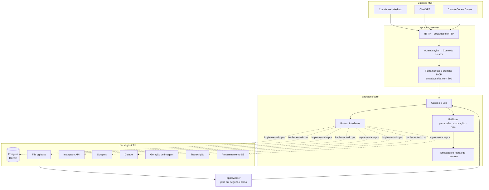
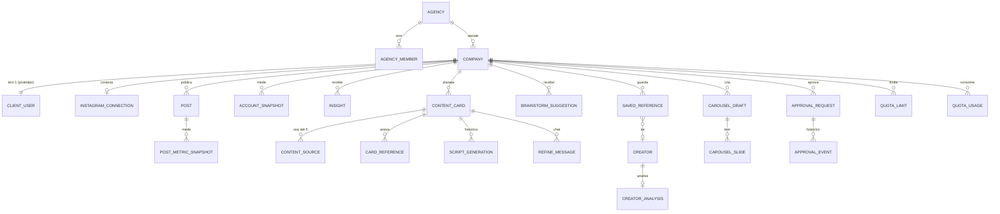
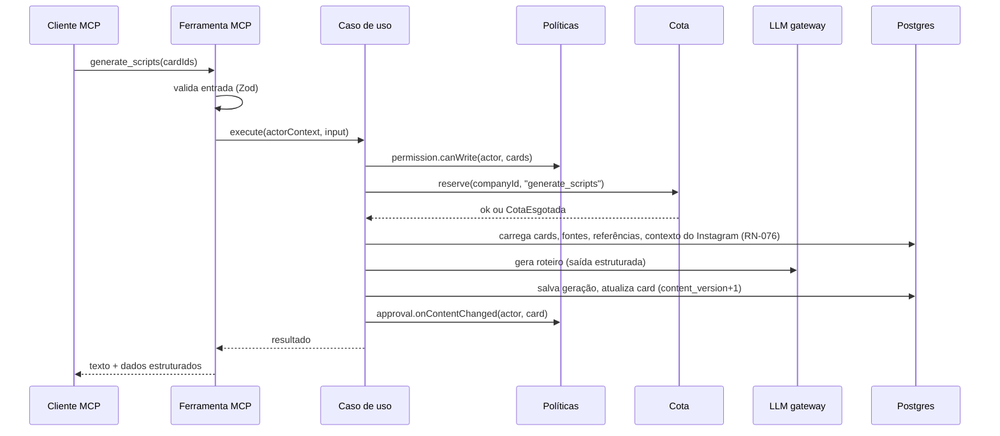

# Software Design — ConvergIA

> Deriva de `regra_de_negocio.md` (as regras são citadas por ID, `RN-xxx`) e de `stack.md`.
> Legenda: ✅ confirmado · 💡 recomendação, a confirmar · ❓ em aberto.

## 1. Princípios

1. **As regras de negócio moram no domínio, não nas ferramentas MCP.** A ferramenta MCP só traduz a chamada (valida a entrada e formata a saída). Quem decide se pode, quanto custa e o que muda é o domínio. Assim, quando o app web chegar, ele reaproveita tudo.
2. **Toda operação tem um contexto:** quem é o ator e em qual empresa ele está (RN-020, RN-021). Nenhum caso de uso roda sem esse contexto.
3. **As regras em aberto ficam isoladas** em políticas (`policies/`) com um ponto único de decisão. Quando você responder uma pergunta `Q-xx`, muda uma política, não o sistema inteiro.
4. **O que é lento roda em segundo plano** (scraping, IA longa, render) e a ferramenta devolve um status para consultar, como no Dalea.
5. **Tudo que vem de fora fica atrás de uma interface** (Instagram, scraping, IA, imagem, transcrição, armazenamento). Trocar de fornecedor muda um adaptador.

## 2. Arquitetura

Arquitetura em camadas (hexagonal), com dois processos: o servidor MCP e o worker.



Regra de dependência: `apps → core ← infra`. O `core` não importa nada de `infra` nem do SDK MCP; ele só conhece as interfaces (portas).

## 3. Estrutura de pastas

```text
convergia/
├── apps/
│   ├── mcp-server/
│   │   └── src/
│   │       ├── main.ts                   # sobe o Hono e o transporte Streamable HTTP
│   │       ├── auth/                     # valida token → monta o ContextoDoAtor
│   │       │   ├── oauth-metadata.ts     # /.well-known/oauth-protected-resource
│   │       │   └── resolve-actor.ts
│   │       ├── tools/                    # uma pasta por módulo; cada arquivo = 1 ferramenta MCP
│   │       │   ├── acesso/
│   │       │   ├── desempenho/
│   │       │   ├── conteudo/
│   │       │   ├── roteiros/
│   │       │   ├── ideias/
│   │       │   ├── referencias/
│   │       │   ├── carrossel/
│   │       │   ├── aprovacao/
│   │       │   ├── cotas/
│   │       │   └── busca/
│   │       ├── prompts/                  # prompts MCP (ver §7)
│   │       ├── errors/to-mcp-result.ts   # erro de domínio → { isError: true, mensagem PT-BR }
│   │       └── registry.ts               # registra ferramentas e prompts
│   └── worker/
│       └── src/
│           ├── main.ts
│           └── jobs/                     # sync-metricas, scrape-referencia, extrair-fonte,
│                                         # analisar-post, gerar-carrossel, renovar-token-ig
├── packages/
│   ├── core/                             # SEM dependências de infraestrutura
│   │   └── src/
│   │       ├── shared/
│   │       │   ├── actor-context.ts      # ContextoDoAtor
│   │       │   ├── domain-error.ts       # erros de negócio tipados
│   │       │   └── clock.ts
│   │       ├── acesso/                   # Agência, Empresa, Usuário, papéis
│   │       ├── desempenho/               # Post, Snapshot, Insight, classificação
│   │       ├── conteudo/                 # Card, Fonte, Referência anexada
│   │       ├── roteiros/                 # Geração, Refino, Prévia
│   │       ├── ideias/                   # Sugestão de brainstorm
│   │       ├── referencias/              # Referência salva, Criador, Análise
│   │       ├── carrossel/                # Rascunho, Lâmina
│   │       ├── aprovacao/                # SolicitaçãoDeAprovação ⭐
│   │       ├── cotas/                    # Limite, Consumo
│   │       └── policies/                 # ⭐ onde moram as regras em aberto
│   │           ├── permission.policy.ts
│   │           ├── approval.policy.ts
│   │           ├── authorship.policy.ts
│   │           └── quota.policy.ts
│   │       # dentro de cada módulo:
│   │       #   entities/   value-objects/   use-cases/   ports/   *.test.ts
│   ├── infra/
│   │   └── src/
│   │       ├── db/
│   │       │   ├── schema/               # tabelas Drizzle
│   │       │   ├── migrations/
│   │       │   ├── rls.sql               # Row Level Security por company_id
│   │       │   └── repositories/         # implementam as portas de repositório
│   │       ├── queue/pgboss.ts
│   │       ├── instagram/graph-api.adapter.ts
│   │       ├── scraping/scraper.adapter.ts
│   │       ├── ai/
│   │       │   ├── llm-gateway.ts        # único ponto de chamada ao Claude
│   │       │   ├── prompts/              # system prompts versionados
│   │       │   └── schemas/              # saídas estruturadas (roteiro, lâminas, insight...)
│   │       ├── image/image-gen.adapter.ts
│   │       ├── transcription/transcriber.adapter.ts
│   │       ├── render/carousel-renderer.ts   # Satori + Resvg → PNG 1080×1350
│   │       └── storage/s3.adapter.ts
│   └── config/                           # tsconfig, lint, env com validação Zod
├── docs/                                 # estes três .md
├── docker-compose.yml
└── pnpm-workspace.yaml
```

Convenções:
- **Uma ferramenta MCP = um arquivo = um caso de uso.** O arquivo da ferramenta tem no máximo umas 30 linhas: schema de entrada, chamada ao caso de uso e formatação da saída.
- **Código em inglês, mensagens em português.** 💡 Os nomes das ferramentas MCP em inglês `snake_case`, como no Dalea, porque os modelos lidam bem com isso. As descrições ficam em português. ❓ Confirmar.

## 4. Contexto do ator e multiempresa

```ts
type ActorContext = {
  userId: string;
  kind: "agency_member" | "client_user";   // RN-010..016
  agencyId: string;
  companyId: string;                         // empresa em que a operação acontece (RN-021)
  scopes: ("read" | "write")[];              // 📎 RN-024
};
```

Montagem do contexto (`resolve-actor.ts`):
1. Valida o token (OAuth ou chave de API, ✅ RN-023; fornecedor do OAuth ❓ Q-31) e encontra o usuário.
2. **Usuário do cliente:** `companyId` = a empresa dele, sempre. Se a chamada pedir outra empresa → erro "sem acesso" (RN-015).
3. **Membro da agência:** `companyId` vem de um parâmetro da chamada ou da "empresa ativa" (❓ Q-03). Se não houver → erro "informe a empresa".
4. Toda consulta ao banco recebe o `companyId`. Além disso, o RLS do Postgres (`SET app.company_id`) bloqueia o vazamento mesmo que um repositório esqueça o filtro.

## 5. Modelo de domínio

### 5.1 Entidades principais



### 5.2 Campos que todo item aprovável tem

Roteiro (do card), carrossel e sugestão de ideia (RN-201) têm:

| Campo | Por quê |
|---|---|
| `company_id` | Isolamento (RN-015) |
| `created_by_user_id` / `created_by_kind` (`agency` \| `client`) | Quem criou o item. **Não decide a aprovação sozinho** (RN-203). |
| `content_version` (inteiro) | Incrementa **só** quando o conteúdo muda (roteiro, lâminas, texto da ideia). Mover no kanban, mudar a data ou anexar referência não incrementa (RN-203). Também serve à concorrência otimista (📎 RN-074). |
| `approval_status` (`none` \| `in_preparation` \| `pending` \| `approved` \| `rejected`) | Estado de aprovação (§5.4 da regra de negócio), independente da coluna do kanban (❓ Q-15) |
| `current_approval_request_id` | Aponta para a solicitação vigente |

`approval_status = none` é o `SemAprovacao` da regra de negócio (conteúdo só do cliente). A primeira mexida da agência no conteúdo leva o item para `in_preparation` (RN-203), e ele nunca mais volta para `none`.

Observação: no card, o objeto aprovado é o **roteiro**. 💡 Proposta: o `approval_status` fica no card e se refere ao roteiro, já que a data não passa por aprovação (RN-202).

### 5.3 Solicitação de aprovação ⭐

Agregado próprio, separado do item, para guardar o histórico:

```ts
type ApprovalRequest = {
  id: string;
  companyId: string;
  itemType: "script" | "carousel" | "idea";   // RN-201
  itemId: string;
  itemVersion: number;          // content_version atual; muda se a agência editar durante a pendência (RN-216)
  snapshot: unknown;            // cópia do conteúdo da versão atual (o que o cliente vê)
  status: "pending" | "approved" | "rejected" | "cancelled";
  submittedBy: string;          // membro da agência (RN-210)
  submittedAt: Date;
  decidedBy?: string;           // usuário do cliente, ou membro da agência em nome dele
  decidedAt?: Date;
  decidedOnBehalf: boolean;     // true = agência aprovou em nome do cliente (RN-214)
  reason?: string;              // recusa: opcional (RN-212); aprovação em nome: obrigatório (RN-214)
};

type ApprovalEvent = {          // histórico (RN-230)
  requestId: string;
  type: "submitted" | "updated_while_pending" | "cancelled"
      | "approved" | "approved_on_behalf" | "rejected" | "approval_lost";
  actorId: string;
  itemVersion: number;
  reason?: string;
  at: Date;
};
```

`approval.policy.ts` concentra as regras:

```ts
// RN-203: mexida da agência no conteúdo?
isContentChange(change)            // ✅ roteiro, lâminas, texto da ideia (inclui aplicar prévia de refino)
                                   //    ✘ kanban, data, referência, fonte

onContentChanged(actor, item)      // ✅ chamado em toda escrita de conteúdo
  // ator = agência:
  //   none | rejected → in_preparation                     (RN-203, RN-213)
  //   approved        → in_preparation + evento approval_lost (RN-215)
  //   pending         → continua pending; atualiza itemVersion + snapshot
  //                     + evento updated_while_pending      (RN-216)
  // ator = cliente: ver canEdit

canEdit(actor, item)               // ✅ agência: sempre
                                   // ✅ cliente: ✘ se o item está pending (RN-217)
                                   // ❓ cliente em item in_preparation/approved/rejected → NotDecidedYet("Q-26")

canSubmit(actor, item)             // ✅ só agência; item em in_preparation (RN-210)
canCancel(actor, request)          // ✅ só agência; request pending → item volta a in_preparation (RN-218)
canApprove(actor, request, reason) // ✅ cliente da empresa; ou agência com reason obrigatório (RN-211, RN-214)
canReject(actor, request)          // ✅ só cliente; reason opcional (RN-212, RN-214)
onIdeaApproved(suggestion)         // ❓ Q-16: vira card automaticamente? → NotDecidedYet("Q-16")
```

As funções ainda em aberto **lançam `NotDecidedYet`** com o ID da pergunta. Isso falha nos testes em vez de virar uma suposição escondida no código.

💡 **Proteção ao aprovar:** como a agência pode editar durante a pendência (RN-216), `approve_item` e `reject_item` recebem a `itemVersion` que o cliente viu. Se a versão mudou nesse meio-tempo, a decisão é recusada com "O item foi atualizado pela agência. Revise a versão nova." Assim o cliente nunca aprova algo que não viu. ❓ Confirmar.

### 5.4 Cotas

```text
quota_limit (company_id, tool_key, daily_limit)               -- definido pela agência (RN-302)
quota_usage (company_id, tool_key, day, used)                 -- contador por empresa (RN-301)
```

`quota.policy.ts`:
1. Antes da chamada de IA ou scraping: **reserva** atômica (`UPDATE ... SET used = used + 1 WHERE used < limit`). Se nenhuma linha muda → erro "cota esgotada".
2. Se a chamada falhar: ❓ devolve ou não (Q-21, RN-305).
3. O `day` é calculado no fuso definido em ❓ Q-21 (RN-304).
4. O uso da agência dentro da empresa conta na mesma linha (RN-301).

Análise de post já salva **não reserva cota** (📎 RN-050).

## 6. Catálogo de ferramentas MCP do protótipo

Base: as ferramentas do Dalea, **sem** editor de vídeo, módulo de marca, catálogo viral, TikTok e agendamento (regra de negócio §2.2), **com** o módulo de aprovação novo.
Colunas: **E** = escrita · **C** = consome cota · **J** = cria job em segundo plano.

### Acesso e administração
| Ferramenta | Descrição | E | C |
|---|---|---|---|
| `whoami` | Quem sou eu, meu papel e minha empresa (ou empresa ativa) | | |
| `list_companies` | (agência) Lista as empresas clientes | | |
| `set_active_company` | (agência) Seleciona a empresa ativa. ❓ Só existe se Q-03 = "empresa ativa" | ✔ | |
| `create_company`, `create_client_user` | (agência) Cadastro. ❓ Q-06 | ✔ | |
| `get_quota_usage` | Consumo do dia e limites | | |
| `set_quota_limit` | (agência) Define cota por ferramenta (RN-302) | ✔ | |

### Desempenho e insights (Instagram)
| Ferramenta | Descrição | E | C | J |
|---|---|---|---|---|
| `get_instagram_connection` | Status da conexão, origem (oauth \| scrape), última sincronização | | | |
| `connect_instagram` | Gera o link de conexão OAuth. ❓ Q-05 | ✔ | | |
| `get_account_overview` | Seguidores, ganho no período, alcance (7–365 dias) | | | |
| `get_audience_growth` | Crescimento por dia ou semana | | | |
| `list_posts` / `get_post` | Posts com métricas, classificação, transcrição e análise salva | | | |
| `get_performance_summary` | Totais de 7, 30 ou 90 dias, variação contra o período anterior | | | |
| `get_top_performers` | Ranking por visualizações, engajamento, salvamentos... | | | |
| `get_metrics_daily` | Snapshots diários (até 180 dias) | | | |
| `sync_metrics` | Busca métricas novas | ✔ | ✔ | ✔ |
| `analyze_post` | Analisa um post próprio (grátis se já houver análise) | ✔ | ✔ | ✔ |
| `set_post_classification` | Classificação manual (funil, formato, estilo) | ✔ | | |
| `get_insights` | Insights salvos e estado de atualização (nunca regenera) | | | |
| `generate_insights` | Regenera os insights (≥10 vídeos) | ✔ | ✔ | |

### Conteúdo
| Ferramenta | Descrição | E | C | J |
|---|---|---|---|---|
| `list_contents` / `get_content` | Cards (resumo / detalhe completo + status de aprovação) | | | |
| `create_content` / `bulk_create_contents` | Criar 1 card ou de 1 a 20 (sem IA) | ✔ | | |
| `update_content` | Editar campos editoriais. Se mudar conteúdo, aciona `approval.policy.onContentChanged` | ✔ | | |
| `duplicate_content` | Copiar card (sem data, coluna ideia) | ✔ | | |
| `move_content` / `reorder_contents` | Kanban | ✔ | | |
| `schedule_content` / `unschedule_content` | Data no calendário (não publica, RN-062) | ✔ | | |
| `delete_content` | ❓ Q-14, Q-24 | ✔ | | |
| `get_calendar` | Calendário por intervalo de datas | | | |
| `generate_title` | Título com IA | ✔ | ✔ | |
| `attach_content_reference` / `detach_content_reference` / `list_content_references` | Referências do card | ✔ | | |
| `create_content_source_upload` | Link assinado para PDF (2 h) | ✔ | ✔ | |
| `add_content_source` / `get_content_source` / `retry_content_source` | Fontes do card | ✔ | ✔ | ✔ |
| `create_content_from_source` | Cria card a partir de uma fonte | ✔ | ✔ | ✔ |

### Roteiros
| Ferramenta | Descrição | E | C |
|---|---|---|---|
| `generate_scripts` | Roteiro completo para 1 a 5 cards | ✔ | ✔ |
| `generate_hook_options` / `generate_body_options` / `generate_cta_options` / `generate_caption_options` | Até 3 opções | ✔ | ✔ |
| `list_content_generations` | Histórico de gerações | | |
| `refine_content` | Chat de refino. Gera **prévia**, não altera o roteiro | ✔ | ✔ |
| `get_refine_chat` | Últimas mensagens do refino | | |
| `review_content_refinement` | Aplica ou descarta a prévia (recusa se `version` mudou) | ✔ | |

### Ideias
| Ferramenta | Descrição | E | C |
|---|---|---|---|
| `list_brainstorm_suggestions` | Sugestões ativas, com motivo e status de aprovação | | |
| `regenerate_brainstorm` | Novo conjunto de ideias | ✔ | ✔ |
| `accept_brainstorm_suggestion` / `dismiss_brainstorm_suggestion` | Vira card / descarta | ✔ | |

### Referências
| Ferramenta | Descrição | E | C | J |
|---|---|---|---|---|
| `list_saved_references` | Posts e criadores de referência | | | |
| `save_reference_by_url` | Salvar por URL do Instagram (faz scraping se preciso) | ✔ | ✔ | ✔ |
| `delete_saved_reference` | Definitivo (📎 RN-091) | ✔ | | |
| `get_creator_analysis` | Análise salva | | | |
| `run_creator_deep_analysis` | Gera ou devolve a análise salva | ✔ | ✔ | ✔ |

### Carrossel
| Ferramenta | Descrição | E | C | J |
|---|---|---|---|---|
| `create_carousel` | Planeja, escreve e gera a arte | ✔ | ✔ | ✔ |
| `get_carousel_generation` | Progresso: gerando, pronto ou falhou | | | |
| `list_carousel_drafts` / `get_carousel_draft` | Rascunhos e lâminas | | | |
| `render_carousel_draft` | PNGs finais 1080×1350 | | | |

### Aprovação ⭐
| Ferramenta | Quem | Descrição |
|---|---|---|
| `submit_for_approval` | Agência | Envia roteiro, carrossel ou ideia em `in_preparation` (RN-210). Grava `itemVersion` e `snapshot` |
| `list_pending_approvals` | Ambos | Cliente: o que tenho para aprovar. Agência: o que está pendente em cada cliente |
| `get_approval_item` | Ambos | Mostra a versão atual enviada e se ela mudou desde o envio (RN-216) |
| `approve_item` | Cliente; agência só com `on_behalf_reason` obrigatório | Aprova (RN-211, RN-214) |
| `reject_item` | Só cliente | Recusa com motivo opcional (RN-212) |
| `cancel_approval_request` | Agência | Cancela o envio; o item volta a `in_preparation` (RN-218) |
| `list_items_to_submit` | Agência | Itens em `in_preparation`: novos, recusados, cancelados ou que perderam a aprovação |
| `get_approval_history` | Ambos | Histórico de envios, edições na pendência, decisões e perdas de aprovação (RN-230) |

### Busca
| Ferramenta | Descrição |
|---|---|
| `search` / `fetch` | Busca no espaço da empresa (cards, referências, criadores) e leitura do resultado. O ChatGPT usa essas duas como padrão. |

## 7. Prompts MCP

Atalhos prontos que o usuário escolhe no cliente MCP. Adaptados do Dalea:

| Prompt | Para quem | O que faz |
|---|---|---|
| `weekly-review` | Ambos | Revisa o desempenho da semana passada e o que mudar |
| `plan-next-week` | Ambos | Preenche a próxima semana com ideias baseadas no brainstorm e no desempenho |
| `source-to-script` | Ambos | Transforma artigo, PDF ou texto em roteiro |
| `reference-research` | Ambos | Estuda criadores de referência |
| `review-approvals` ⭐ | Cliente | "O que a agência me mandou?": lista as pendências e ajuda a aprovar ou recusar |
| `prepare-for-client` ⭐ | Agência | Gera, revisa e envia para aprovação um lote de conteúdo de um cliente |

O `brand-strategy-onboarding` do Dalea fica de fora até existir o módulo de marca.

## 8. Fluxos principais

### 8.1 Chamada típica de ferramenta com IA



### 8.2 Aprovação

```mermaid
sequenceDiagram
    participant AG as Agência (MCP)
    participant CL as Cliente (MCP)
    participant S as Sistema

    AG->>S: generate_scripts / create_carousel (mexida no conteúdo)
    S->>S: onContentChanged → in_preparation (RN-203)
    AG->>S: submit_for_approval(item)
    S->>S: canSubmit? grava snapshot + versão, status = pending
    Note over S: ❓ Q-20: notificar o cliente?
    opt agência edita durante a pendência (RN-216)
        AG->>S: update_content / refine
        S->>S: pendência continua; nova versão + snapshot
    end
    CL->>S: list_pending_approvals
    CL->>S: get_approval_item(id)
    alt cliente aprova
        CL->>S: approve_item(id, versãoVista)
        S->>S: approved
    else cliente recusa
        CL->>S: reject_item(id, versãoVista, motivo opcional)
        S->>S: rejected → volta para a agência
    else cliente aprovou fora (ex.: WhatsApp)
        AG->>S: approve_item(id, on_behalf_reason) (RN-214)
        S->>S: approved, decidedOnBehalf = true
    else agência desiste
        AG->>S: cancel_approval_request(id) (RN-218)
        S->>S: cancelled → in_preparation
    end
    opt agência mexe no conteúdo depois de aprovado (RN-215)
        AG->>S: update_content
        S->>S: approval_lost → in_preparation
    end
```

### 8.3 Job em segundo plano

`create_carousel`, `save_reference_by_url`, `add_content_source`, `sync_metrics` e `analyze_post`:
1. A ferramenta reserva a cota, cria o registro com status `queued` e enfileira o job.
2. Devolve na hora o ID e a instrução "consulte com `get_...`".
3. O worker processa, atualiza o progresso e termina em `ready` ou `failed` (com mensagem).
4. ❓ Se falhar, a cota é devolvida? (Q-21)

## 9. Concorrência e consistência

- **Concorrência otimista** por `version` em card, roteiro e carrossel. Aplicar prévia de refino com versão desatualizada → erro (📎 RN-074).
- **Envio para aprovação** guarda `itemVersion`, atualizada a cada edição da agência durante a pendência (RN-216). Aprovar ou recusar exige a versão que o cliente viu (💡 §5.3).
- **Toda escrita de conteúdo passa por `approval.policy.onContentChanged`** na mesma transação da alteração. Assim, nenhum caminho de código consegue mudar conteúdo aprovado sem que ele perca a aprovação (RN-215).
- **Cota** com `UPDATE` condicional atômico (sem condição de corrida entre agência e cliente usando ao mesmo tempo).
- **Idempotência** dos jobs: cada job tem uma chave (ex.: `sync:{companyId}:{hora}`), então a repetição não duplica dados.

## 10. Auditoria e observabilidade

- `audit_log` para toda escrita: ator, empresa, ferramenta, ID do item, antes/depois (resumo), data.
- `ai_call_log` para toda chamada de IA: empresa, ferramenta, modelo, tokens de entrada e saída, duração, sucesso ou erro. Base para medir custo por empresa e definir o preço futuro (Q-30).
- Logs estruturados com `requestId`, `userId`, `companyId`. Erros inesperados vão para o Sentry; o usuário vê só a mensagem genérica.

## 11. Testes

| Nível | O que cobre | Prioridade |
|---|---|---|
| **Unitário de domínio** | Todas as políticas: permissão, aprovação, autoria, cota. Um teste por RN ✅ | ⭐ Máxima |
| **Isolamento** | Usuário da empresa A nunca lê nem altera dados da empresa B, ferramenta por ferramenta | ⭐ Máxima |
| **Integração** | Casos de uso com Postgres real (Docker), filas e cota concorrente | Alta |
| **Contrato MCP** | Cada ferramenta lista schema e descrição válidos; erros saem como `isError` | Média |
| **IA** | Conjunto pequeno de cards reais por segmento (móveis, roupa, personal...) para comparar a qualidade do roteiro ao trocar modelo ou prompt | Média |

Regras ❓ têm teste que espera `NotDecidedYet`. Quando a pergunta é respondida, o teste é reescrito com a regra nova.

## 12. Ordem sugerida de implementação 💡

1. Esqueleto: monorepo, Postgres, servidor MCP com `whoami`, autenticação por chave de API e por OAuth (RN-023; o OAuth depois de Q-31).
2. Multiempresa e permissões (§4) + testes de isolamento.
3. Conexão do Instagram e sincronização de métricas (começar a revisão da Meta no dia 1).
4. Cards, kanban e calendário (sem IA).
5. LLM gateway + cotas + geração e refino de roteiro.
6. **Aprovação** (regras definidas; falta só Q-26, sobre o cliente editar).
7. Brainstorm, referências, fontes.
8. Carrossel (depois de escolher o provedor de imagem).
9. Insights e análise de post (depois de escolher o provedor de transcrição).
